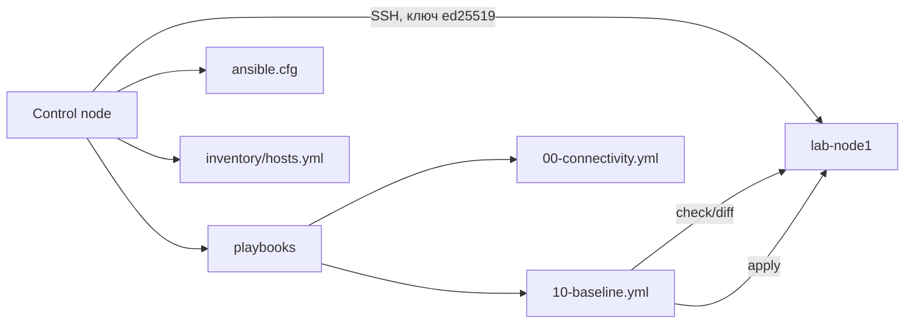

# Быстрый старт: первый безопасный playbook

Цель — за 30–60 минут получить работающий control node, подключиться к тестовому хосту и применить идемпотентный playbook с проверкой через `--check --diff` и откатом. Всё выполняется в лаборатории или на одном тестовом хосте.

## 1. Зачем это нужно

Первый запуск задаёт привычки: использовать отдельную учётную запись, проверять изменения до применения, фиксировать версии и уметь откатываться. Если начать с копирования чужого «харденинг-плейбука» в продакшен, риск самоблокировки и потери доступа резко возрастает.

## 2. Ключевые понятия

| Понятие | Что означает в этом сценарии |
|---|---|
| Control node | ваша машина с ansible-core, откуда запускаются playbook |
| Managed node | тестовая ВМ, к которой подключаемся по SSH |
| Inventory | YAML-файл с адресом и учётной записью тестового хоста |
| Idempotency | повторный запуск не меняет уже настроенную систему |
| Check mode | `--check` показывает план без изменений |
| Diff mode | `--diff` показывает различия файлов |
| Blast radius | в этом сценарии — один тестовый хост |
| ansible.cfg | локальная конфигурация проекта, приоритетнее глобальной |

## 3. Схема



## 4. Пошаговая реализация

### Шаг 1. Подготовьте control node

Нужна Linux-машина с Python 3.10–3.12: Ubuntu 24.04, Debian 12 или RHEL 9 с python3.11. На RHEL 9 системный Python 3.9 не подходит для ansible-core 2.17+ на control node.

Ubuntu/Debian:

```bash
sudo apt update
sudo apt install -y python3 python3-venv python3-pip
python3 -m venv ~/.venvs/ansible
source ~/.venvs/ansible/bin/activate
python -m pip install --upgrade pip
pip install "ansible-core~=2.17.0"
ansible --version
```

RHEL 9 / Rocky 9 / AlmaLinux 9 (через python3.11):

```bash
sudo dnf install -y python3.11 python3.11-pip
python3.11 -m venv ~/.venvs/ansible
source ~/.venvs/ansible/bin/activate
python -m pip install --upgrade pip
pip install "ansible-core~=2.17.0"
ansible --version
```

`ansible --version` должен показать версию core, Python control node, путь к `ansible.cfg` и каталоги коллекций. Если команда не найдена — активируйте venv или проверьте `PATH`.

### Шаг 2. Создайте проект

```bash
mkdir -p ~/ansible-lab/{inventory,playbooks}
cd ~/ansible-lab
```

Структура:

```text
ansible-lab/
  ansible.cfg
  inventory/
    hosts.yml
  playbooks/
    00-connectivity.yml
    10-baseline.yml
```

### Шаг 3. Подготовьте тестовый хост

На тестовой ВМ создайте отдельного пользователя и каталог для ключа. Не используйте root для входа.

```bash
sudo useradd -m -s /bin/bash ansible
sudo install -d -m 0700 -o ansible -g ansible /home/ansible/.ssh
```

Для лаборатории разрешите беспарольный sudo. В продакшене ограничьте команды и группы.

```bash
echo 'ansible ALL=(ALL) NOPASSWD:ALL' | sudo tee /etc/sudoers.d/90-ansible-lab
sudo chmod 0440 /etc/sudoers.d/90-ansible-lab
sudo visudo -cf /etc/sudoers.d/90-ansible-lab
```

`visudo -cf` проверяет синтаксис файла. Если проверка не прошла — не оставляйте файл включённым.

### Шаг 4. Создайте SSH-ключ и скопируйте его

На control node:

```bash
ssh-keygen -t ed25519 -a 100 -C "ansible-control" -f ~/.ssh/ansible_ed25519
ssh-copy-id -i ~/.ssh/ansible_ed25519.pub ansible@192.0.2.10
```

Для продакшена задайте парольную фразу и используйте `ssh-agent`, SSH-сертификаты или короткоживущие ключи. Проверьте доступ и sudo:

```bash
ssh -i ~/.ssh/ansible_ed25519 ansible@192.0.2.10 'id && sudo -n true && echo OK'
```

Ожидаемый результат — строка `OK` без запроса пароля sudo. При первом подключении сверьте отпечаток ключа хоста с эталоном; не отключайте проверку host key.

### Шаг 5. Создайте ansible.cfg

```ini
[defaults]
inventory = ./inventory/hosts.yml
host_key_checking = True
interpreter_python = auto_silent
forks = 10
retry_files_enabled = False
deprecation_warnings = True
# log_path = ./logs/ansible.log

[ssh_connection]
pipelining = True
```

`host_key_checking = True` — обязательное значение. `pipelining` ускоряет работу, но может конфликтовать с `requiretty` в sudo: при ошибке tty временно установите `pipelining = False`. Подробнее — в разделе «Типичные ошибки».

### Шаг 6. Создайте inventory

`inventory/hosts.yml`:

```yaml
all:
  children:
    lab:
      hosts:
        lab-node1:
          ansible_host: 192.0.2.10
          ansible_user: ansible
          ansible_ssh_private_key_file: ~/.ssh/ansible_ed25519
          # Для RHEL/Rocky/AlmaLinux 8 раскомментируйте:
          # ansible_python_interpreter: /usr/bin/python3.9
```

Если `~` не раскрывается в вашей версии, укажите абсолютный путь к ключу. Для RHEL 8 установите `python39` и задайте интерпретатор явно: системный Python 3.6 не поддерживается ansible-core 2.17+ на управляемых узлах.

### Шаг 7. Проверьте подключение

```bash
ansible lab -m ansible.builtin.ping
```

Модуль `ping` не использует ICMP: он проверяет SSH-подключение и запуск Python на целевом узле. Ожидаемый результат:

```text
lab-node1 | SUCCESS => {
    "changed": false,
    "ping": "pong"
}
```

Затем запустите playbook с фактами:

```bash
ansible-playbook playbooks/00-connectivity.yml
```

### Шаг 8. Примените baseline через check mode

```bash
ansible-playbook playbooks/10-baseline.yml --check --diff
```

Изучите план: какие пакеты будут установлены, какие файлы изменятся. На этом этапе ничего не применяется. Убедитесь, что в списке нет неожиданных изменений.

### Шаг 9. Примените и проверьте идемпотентность

```bash
ansible-playbook playbooks/10-baseline.yml
ansible-playbook playbooks/10-baseline.yml
```

Второй запуск должен показать `changed=0` для обеих задач. Если изменения повторяются, значит, задача неидемпотентна или на хосте есть внешний процесс, меняющий файл.

Проверьте файл:

```bash
ansible lab -m ansible.builtin.stat -a "path=/etc/ansible-baseline"
```

Ожидаемые признаки: `exists: true`, `mode: '0644'`, владелец `root`.

### Шаг 10. Откатите изменения

Удалите маркерный файл:

```bash
ansible lab -b -m ansible.builtin.file -a "path=/etc/ansible-baseline state=absent"
```

Пакеты `curl` и `ca-certificates` намеренно не удаляются: они могут использоваться системой и другими пакетами. Для лабораторного стенда при необходимости удалите их отдельно, понимая зависимости.

## 5. Примеры кода

`playbooks/00-connectivity.yml`:

```yaml
---
- name: Verify connectivity and facts
  hosts: lab
  gather_facts: true
  tasks:
    - name: Show target identity
      ansible.builtin.debug:
        msg:
          - "Host: {{ inventory_hostname }}"
          - "OS: {{ ansible_distribution }} {{ ansible_distribution_version }}"
          - "Python: {{ ansible_python_version }}"
```

`playbooks/10-baseline.yml`:

```yaml
---
- name: Apply lab baseline
  hosts: lab
  become: true
  gather_facts: false
  tasks:
    - name: Ensure baseline packages are present
      ansible.builtin.package:
        name:
          - curl
          - ca-certificates
        state: present

    - name: Write baseline marker
      ansible.builtin.copy:
        dest: /etc/ansible-baseline
        content: |
          managed_by=ansible
          profile=lab-baseline
        owner: root
        group: root
        mode: "0644"
```

`become: true` на уровне play упрощает пример. В продакшене повышение привилегий лучше указывать только на задачах, которым оно действительно нужно.

## 6. Проверка результата

- `ansible --version` показывает ansible-core 2.17.x и Python 3.10–3.12.
- `ansible lab -m ansible.builtin.ping` возвращает `pong`.
- `--check --diff` показывает ожидаемые изменения без применения.
- Первый реальный запуск завершается `changed=2`, второй — `changed=0`.
- `stat` подтверждает файл `/etc/ansible-baseline` с правами `0644`.
- Откат удаляет маркерный файл и не ломает систему.

## 7. Безопасность и blast radius

- **Blast radius:** один тестовый хост. Не расширяйте inventory до продакшена, пока не проверите идемпотентность и откат.
- **Учётная запись:** отдельный пользователь `ansible`, не root; беспарольный sudo — только в лаборатории.
- **Ключи:** парольная фраза и ssh-agent или SSH-сертификаты; не переиспользуйте личные ключи.
- **Host key:** проверка включена; отпечаток сверяется с эталоном.
- **Секреты:** в примерах их нет; для реальных секретов используйте `ansible-vault` или внешнее хранилище, а не `--extra-vars` в командной строке.
- **Откат:** удаление маркерного файла безопасно; удаление пакетов требует анализа зависимостей.
- **Логи:** включите `log_path`, если нужен аудит запусков; защитите каталог логов.

## 8. Комплаенс-маппинг

Сценарий создаёт доказательства управляемого изменения: коммит в Git, вывод `--check --diff`, журнал запуска и результат повторного прогона с `changed=0`. Это поддерживает практики управления изменениями и контроля конфигурации, но не заменяет формальный маппинг контролей CIS/STIG/ISO/NIST — он приведён на странице «Комплаенс и доказательства».

## 9. Типичные ошибки

| Симптом | Причина | Решение |
|---|---|---|
| `Permission denied (publickey)` | неверный пользователь, путь к ключу или права | проверьте `ansible_user`, путь к ключу, права `700` на `~/.ssh` и `600` на ключ |
| `Host key verification failed` | ключ хоста отсутствует или изменился | сверьте отпечаток с эталоном и добавьте корректный ключ; не отключайте проверку |
| `sudo: a password is required` | нет NOPASSWD и не передан пароль | настройте ограниченный sudoers или запускайте с `-K` |
| `python3 not found` | на узле нет Python | установите python3; для RHEL 8 — python39 и явный `ansible_python_interpreter` |
| `couldn't resolve module/action` | коллекция не установлена | установите коллекцию и используйте FQCN |
| `externally-managed-environment` | pip блокирован PEP 668 | используйте venv или pipx, не `--break-system-packages` |
| `sudo: sorry, you must have a tty` | `requiretty` и pipelining | установите `pipelining = False` или исправьте sudoers |
| `UNREACHABLE` | сеть, VPN, firewall или неверный адрес | проверьте `ssh` вручную, маршрут и правило firewall |
| Повторный запуск показывает `changed` | задача неидемпотентна | замените `shell` модулем, проверьте `changed_when` и внешние процессы |

## 10. Чек-лист

- [ ] Control node с Python 3.10–3.12 и ansible-core 2.17+.
- [ ] Версия зафиксирована в venv и будет закреплена в репозитории.
- [ ] Отдельный пользователь и ключ; root для входа не используется.
- [ ] `host_key_checking = True`, отпечаток сверен.
- [ ] Inventory ограничен одним тестовым хостом.
- [ ] `--check --diff` просмотрен до применения.
- [ ] Повторный запуск даёт `changed=0`.
- [ ] Откат проверен.
- [ ] Секретов в репозитории и истории команд нет.
- [ ] Следующий шаг — основы и установка в филиальной среде.

## 11. Источники

- [Ansible installation guide](https://docs.ansible.com/ansible/latest/installation_guide/intro_installation.html)
- [Ansible inventory guide](https://docs.ansible.com/ansible/latest/inventory_guide/index.html)
- [Ansible playbook guide](https://docs.ansible.com/ansible/latest/playbook_guide/index.html)
- [Check mode and diff mode](https://docs.ansible.com/ansible/latest/playbook_guide/playbooks_checkmode.html)
- [Releases and maintenance](https://docs.ansible.com/ansible/latest/reference_appendices/release_and_maintenance.html)
- [Ansible collections guide](https://docs.ansible.com/ansible/latest/collections_guide/index.html)

## 12. Связанные страницы

- [Маршруты чтения](reading-paths.md)
- [Глоссарий](glossary.md)
- [Основы Ansible](../fundamentals/01-concepts.md)
- [Архитектура и компоненты](../fundamentals/02-architecture.md)
- [Установка и версионирование](../fundamentals/03-install.md)
- Конфигурация ansible.cfg — в разработке
- Inventory и группы — в разработке
- Безопасная разработка playbook — в разработке
