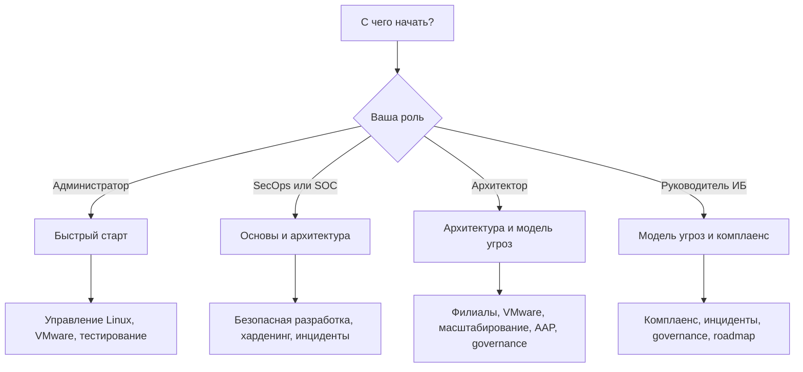

# Маршруты чтения

Вики покрывает и администрирование, и кибербезопасность, поэтому читать её целиком подряд не обязательно. Выберите маршрут по роли и задаче. Ориентировочное время указано для вдумчивого чтения с выполнением примеров в лаборатории.

## 1. Зачем это нужно

Без маршрута легко застрять: начать с харденинга, не понимая inventory, или изучать API vCenter, не освоив playbook. Маршруты задают порядок, при котором каждая следующая страница опирается на предыдущую, а практические результаты накапливаются.

## 2. Ключевые понятия

| Роль | Основная цель | Время | Итог |
|---|---|---|---|
| Системный администратор | автоматизировать рутину и филиалы | 2–3 недели | рабочий control node, первые роли, отчёты о дрейфе |
| SecOps / SOC | внедрить харденинг, контроль и реагирование | 3–4 недели | baseline CIS/STIG, секреты, EDA-пилот, playbook-изоляция |
| Архитектор | выбрать стек и спроектировать управление | 5–7 дней выборочно | обоснованный стек, схема филиалов и VMware, roadmap |
| Руководитель ИБ | понять этапы, риски и метрики | 1–2 дня выборочно | roadmap 30/90/180, критерии приёмки, метрики |

## 3. Схема выбора

## 4. Пошаговая реализация

### 4.1. Системный администратор

Цель: от первого подключения до управляемой филиальной сети.

1. [Быстрый старт](quickstart.md) — 2–3 часа. Control node, SSH, inventory, первый playbook.
2. [Основы Ansible](../fundamentals/01-concepts.md) — 1 час. Понять agentless-модель, идемпотентность и границы применимости.
3. [Архитектура и компоненты](../fundamentals/02-architecture.md) — 1,5 часа. Разобраться, где хранятся ключи, коллекции и Execution Environments.
4. [Установка и версионирование](../fundamentals/03-install.md) — 2 часа. Зафиксировать версии, настроить управляемые узлы.
5. Конфигурация ansible.cfg — 1,5 часа (в разработке).
6. Inventory и группы — 2 часа (в разработке). Сразу проектируйте иерархию под филиалы.
7. Переменные и факты — 2 часа (в разработке).
8. Playbooks и roles — 3 часа (в разработке).
9. Модули и FQCN — 2 часа (в разработке).
10. Управление Linux — 3 часа (в разработке).
11. Конфигурация и дрейф — 2 часа (в разработке).
12. VMware ESXi и vCenter — 3 часа (в разработке).
13. Масштабирование — 2,5 часа (в разработке).
14. Тестирование — 3 часа (в разработке).
15. Troubleshooting — по мере необходимости (в разработке).

**Результат:** воспроизводимый control node, playbook для базовой настройки хоста, понимание ограничений WAN и VMware.

### 4.2. SecOps / SOC

Цель: автоматизировать защитные процессы, не создав новый вектор атаки.

1. [Основы Ansible](../fundamentals/01-concepts.md) — 1 час.
2. Inventory и группы — 2 часа (в разработке). Отделите production, филиалы и лабораторию.
3. Модель угроз автоматизации — 2,5 часа (в разработке). Control node — tier-0 актив.
4. Управление секретами — 3 часа (в разработке).
5. Доступ и привилегии — 2,5 часа (в разработке).
6. Безопасная разработка playbook — 3 часа (в разработке).
7. Аудит выполнения — 2 часа (в разработке).
8. Харденинг Linux — 3,5 часа (в разработке).
9. SSH, PAM, sudo — 2,5 часа (в разработке).
10. Firewall — 2 часа (в разработке).
11. Ядро и системный аудит — 2,5 часа (в разработке).
12. Логирование и мониторинг — 2 часа (в разработке).
13. Уязвимости и патчи — 2,5 часа (в разработке).
14. Комплаенс и доказательства — 3 часа (в разработке).
15. Реагирование на инциденты — 3 часа (в разработке).
16. Event-Driven Ansible — 2 часа (в разработке), после пилота реагирования.

**Результат:** threat model автоматизации, схема секретов, baseline харденинга, отчётность для аудита, пилот изоляции хоста.

### 4.3. Архитектор

Цель: принять решения по стеку и топологии до масштабной раскатки.

1. [Архитектура и компоненты](../fundamentals/02-architecture.md) — 1,5 часа.
2. Модель угроз — 2,5 часа (в разработке).
3. Распределённые филиалы — 3 часа (в разработке).
4. VMware ESXi и vCenter — 3 часа (в разработке).
5. Масштабирование — 2,5 часа (в разработке).
6. Харденинг ESXi/vCenter — 3 часа (в разработке).
7. Комплаенс — 3 часа (в разработке).
8. Zero trust и JIT-доступ — 2 часа (в разработке).
9. AAP, AWX, Semaphore — 3 часа (в разработке).
10. Governance — 2,5 часа (в разработке).
11. Дорожная карта — 2 часа (в разработке).

**Результат:** выбор стека с обоснованием, схема управления филиалами, критерии приёмки, план на 30/90/180 дней.

### 4.4. Руководитель ИБ

Цель: понять, что внедряется, зачем и как измеряется.

1. [Главная](../index.md) — 15 минут.
2. Модель угроз автоматизации — 2,5 часа (в разработке).
3. Комплаенс и доказательства — 3 часа (в разработке).
4. Реагирование на инциденты — 3 часа (в разработке).
5. Governance — 2,5 часа (в разработке).
6. Дорожная карта — 2 часа (в разработке).

**Результат:** понимание рисков, этапов, KPI и требований к команде; согласованный roadmap.

## 5. Проверка результата

Контрольные точки после каждого маршрута:

- **Администратор:** объясняет, чем модуль отличается от `shell`; запускает playbook повторно и получает `changed=0`; понимает, почему `serial` ограничивает blast radius.
- **SecOps / SOC:** формулирует три угрозы control node и контроли для них; показывает, где хранятся секреты и как они ротируются; запускает проверку дрейфа и читает отчёт.
- **Архитектор:** обосновывает выбор AWX или AAP; описывает путь управления из ЦОД в филиал при обрыве WAN; называет метрики внедрения.
- **Руководитель ИБ:** называет этапы 30/90/180, критерии успеха и остаточные риски.

## 6. Безопасность и blast radius

- Начинайте с лаборатории или одного тестового хоста; не запускайте первые playbook в продакшене.
- Используйте `--check --diff`, затем канареечный хост, затем раскатку по филиалам.
- Для обучения — отдельная учётная запись, отдельный inventory и отдельные ключи; не переиспользуйте продакшн-ключи.
- Не копируйте playbook и роли из непроверенных источников: коллекции и роли — часть цепочки поставок.
- Секреты не храните в репозитории и не передавайте через `--extra-vars` в командной строке.

## 7. Комплаенс-маппинг

Маршруты сами по себе не покрывают контроли. Они формируют компетенции, необходимые для страниц «Харденинг Linux», «Комплаенс и доказательства» и «Governance», где приводится маппинг «контроль → playbook → доказательство» для CIS, STIG, ISO/IEC 27001, NIST CSF 2.0 и национальных требований.

## 8. Типичные ошибки

| Симптом | Причина | Решение |
|---|---|---|
| Изучение начинается с харденинга | пропущены основы | вернуться к quickstart и основам |
| Первый запуск в продакшене | нет лаборатории | поднять тестовую ВМ и снимок |
| Playbook работает «через раз» | нет идемпотентности | заменить `shell` модулями, проверить повторный прогон |
| Ошибки доступа и ключей | общая учётная запись | отдельный сервисный пользователь и ключи |
| Версии не зафиксированы | установка «что дали» | venv/pipx и точные версии коллекций |
| Роли из интернета без проверки | нет ревью supply chain | приватный хаб, пины, подпись, ревью |

## 9. Чек-лист

- [ ] Выбрана роль и маршрут.
- [ ] Подготовлена лаборатория и снимок ВМ.
- [ ] Определены ограничения: один хост, тестовый inventory.
- [ ] Зафиксированы версии ansible-core и коллекций.
- [ ] Пройдены контрольные точки маршрута.
- [ ] Секреты и ключи не пересекаются с продакшеном.
- [ ] Следующая страница выбрана по маршруту.

## 10. Источники

- [Ansible installation guide](https://docs.ansible.com/ansible/latest/installation_guide/intro_installation.html)
- [Ansible playbook guide](https://docs.ansible.com/ansible/latest/playbook_guide/index.html)
- [Ansible collections guide](https://docs.ansible.com/ansible/latest/collections_guide/index.html)
- [Releases and maintenance](https://docs.ansible.com/ansible/latest/reference_appendices/release_and_maintenance.html)

## 11. Связанные страницы

- [Главная](../index.md)
- [Глоссарий](glossary.md)
- [Быстрый старт](quickstart.md)
- [Основы Ansible](../fundamentals/01-concepts.md)
- [Архитектура и компоненты](../fundamentals/02-architecture.md)
- [Установка и версионирование](../fundamentals/03-install.md)
